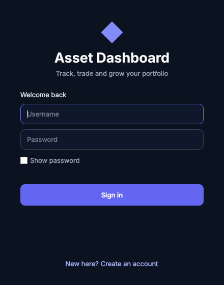
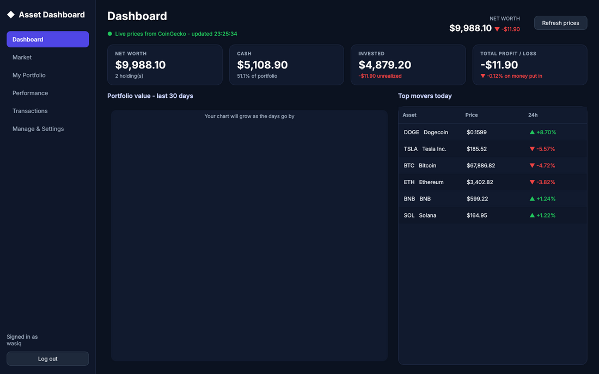
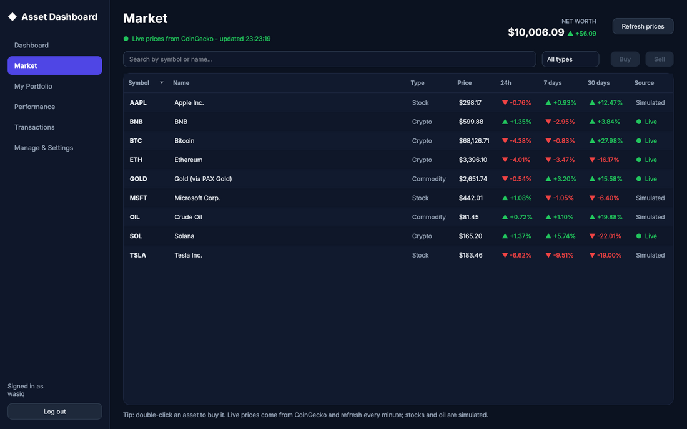
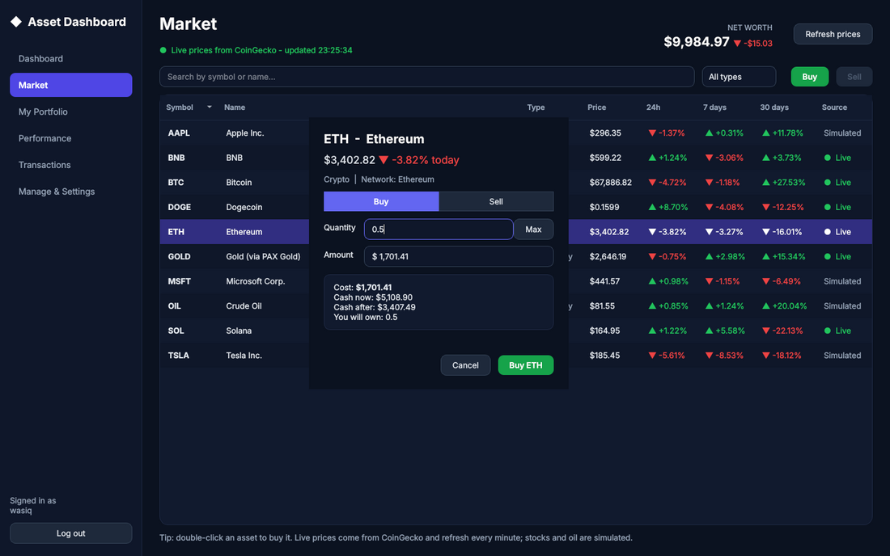
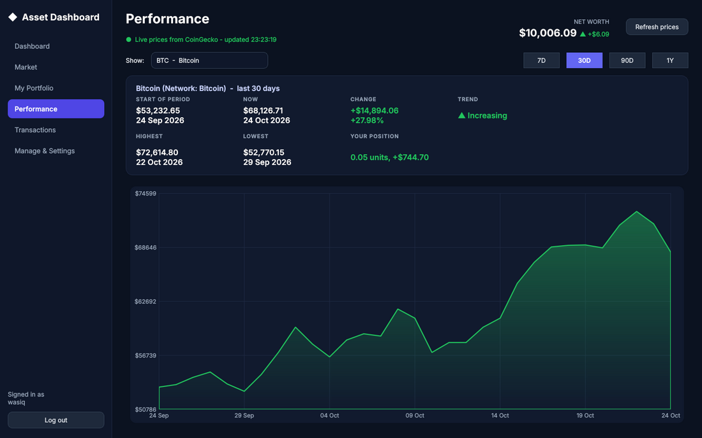
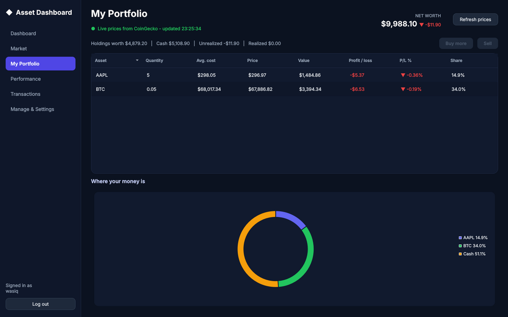

# Asset Management Dashboard (C++ / Qt)

A desktop app where each user signs in with a username and password, then **buys and sells
assets**, **manages** their portfolio and cash, and **sees how values change over time**
(rising or falling, by how much, with charts).

- **Live prices** for crypto (BTC, ETH, SOL, BNB, plus any coin you add) and gold come from
  the **CoinGecko API**. See [docs/COINGECKO_GUIDE.md](docs/COINGECKO_GUIDE.md) for how that works.
- **Stocks and oil are simulated** (CoinGecko has no stock prices), with one random price move
  per day plus small moves every few seconds so the screen feels alive.
- Written in **C++17** with **Qt 6** (Widgets, Network, Charts).

| | |
|---|---|
|  |  |
|  |  |
|  |  |

## Features

| Screen | What you can do |
|---|---|
| **Login** | Create an account (username rules, password needs 6+ chars with a letter and a number) or sign in. Each user has their own portfolio. New users start with $10,000. |
| **Dashboard** | Net worth, cash, invested amount, total profit/loss, 30-day portfolio chart, today's top movers |
| **Market** | All assets with price and % change over 24h / 7 days / 30 days, live vs simulated badge, search and filter, Buy / Sell |
| **Trade dialog** | Enter a quantity *or* a dollar amount; shows cost, cash after, and profit on a sale. Stocks are whole shares only; crypto can be fractional |
| **My Portfolio** | Quantity, average cost, current price, value, profit/loss (in $ and %), share of portfolio, allocation doughnut chart |
| **Performance** | Pick an asset or the whole portfolio and a period (7D / 30D / 90D / 1Y): start vs now, change, trend (increasing / decreasing), highest / lowest, your position's change, chart |
| **Transactions** | Full history, filter by type, export to CSV |
| **Manage & Settings** | Deposit / withdraw cash, add a new asset (live with a CoinGecko id, or simulated), remove an asset, set your CoinGecko API key |

If the internet is down, the app keeps working with the last saved prices, shows a red status
message, and won't let you trade a live coin until a fresh price arrives
([screenshot](docs/screenshots/offline.png)).

The portfolio chart shows *your* real history, so a brand-new account fills it in from day two.
Asset charts show up to a year of history straight away.

## Getting started

### 1. Install Qt (Windows)

1. Download the **Qt Online Installer** from <https://www.qt.io/download-qt-installer-oss>
   and sign in (a free Qt account is enough for open-source/student use).
2. Choose **Custom installation** and tick:
   - **Qt 6.x → MinGW 64-bit** (6.4 or newer)
   - **Qt 6.x → Additional Libraries → Qt Charts**
   - **Developer and Designer Tools → Qt Creator, CMake, Ninja, MinGW**
3. Finish the installation.

On macOS, use the same installer. On Ubuntu:
`sudo apt install qt6-base-dev qt6-charts-dev cmake g++`.

### 2. Open and run

1. Start **Qt Creator** → *File → Open File or Project* → choose `asset-dashboard/CMakeLists.txt`.
2. Pick the *Desktop Qt 6.x MinGW 64-bit* kit → **Configure Project**.
3. Select the **AssetDashboard** target (bottom-left) and press the green **Run** button.

Or from a terminal:

```bash
cd asset-dashboard
cmake -S . -B build -DCMAKE_PREFIX_PATH=<path-to-Qt>/6.x/mingw_64   # path not needed on Linux
cmake --build build
./build/AssetDashboard          # Windows: build\AssetDashboard.exe
```

### 3. Add your CoinGecko key

CoinGecko requires a free **Demo API key**. Create one at
<https://www.coingecko.com/en/api/pricing>, then in the app go to **Manage & Settings →
CoinGecko live prices**, paste it and press **Save & test**.

### 4. Run the tests

```bash
cd build
ctest --output-on-failure
```

- `core_tests` checks trading, profit/loss, price history, saving/loading, passwords and SHA-256.
  It needs no Qt, just a C++ compiler.
- `api_tests` checks the CoinGecko code against a fake server, so no internet is needed.

### Sharing the .exe with your group

After building in Release mode on Windows, run Qt's deploy tool so the `.exe` works on a PC
without Qt installed:

```bash
windeployqt build\AssetDashboard.exe
```

## Where data is saved

Accounts and portfolios are stored in your user app-data folder, **not** in the project, so
they're never pushed to GitHub:

- Windows: `C:\Users\<you>\AppData\Roaming\AssetDashboard\AssetDashboard\`
- Linux: `~/.local/share/AssetDashboard/AssetDashboard/`

| File | Contents |
|---|---|
| `users.txt` | `username|salt|hash`, never the password itself |
| `<username>.dat` | That user's assets, price history, holdings and transactions (one record per line, fields separated by `|`) |

## Project structure

```
asset-dashboard/
├── core/                  plain C++17, no Qt (testable on its own)
│   ├── include/  Asset.h, AssetTypes.h, Market.h, Portfolio.h, Transaction.h,
│   │             User.h, AuthManager.h, Sha256.h, Storage.h, DateUtil.h, Exceptions.h
│   └── src/
├── api/                   Qt Network: talking to CoinGecko
│   ├── PriceProvider.h         abstract interface
│   ├── CoinGeckoClient.*       HTTP requests, rate limiting, errors
│   └── CoinGeckoParser.*       JSON -> C++ values
├── gui/                   Qt Widgets: everything you see
│   ├── main.cpp, MainWindow.*, LoginDialog.*, TradeDialog.*
│   ├── Page.h                  base class of every screen
│   ├── pages/                  Dashboard, Market, Portfolio, Performance, Transactions, Manage
│   ├── Charts.*, StatCard.*, Format.*
│   └── resources/style.qss     the dark theme (CSS-like)
├── tests/                 core_tests.cpp, api_tests.cpp
└── docs/                  COINGECKO_GUIDE.md, TEAM_PLAN.md, screenshots/
```

## Class diagram

```
                    +---------------------------+
                    |     Asset  (abstract)     |
                    |---------------------------|
                    | # symbol_, name_, apiId_  |
                    | # history_ : map<Day,$>   |
                    |---------------------------|
                    | + getCurrentPrice()       |
                    | + percentChangeOver(days) |
                    | + historyOver(days)       |
                    | + isLive()                |
                    | + getType() = 0           |  <- pure virtual
                    | + dailyDrift() = 0        |
                    | + allowsFractional() = 0  |
                    +-------------^-------------+
           +----------------------+----------------------+
     +-----+-----+          +-----+-----+          +-----+------+
     |   Stock   |          |  Crypto   |          | Commodity  |
     |  sector_  |          | network_  |          |   unit_    |
     +-----------+          +-----------+          +------------+

  Market    1 --owns--> * Asset            (unique_ptr: composition)
  User      1 --has---> 1 Portfolio        (composition)
  Portfolio 1 --has---> * Transaction, * Holding
  AuthManager --uses--> sha256Hex()        (salted + repeated hashing)
  Storage     --friend of--> Portfolio, User

  PriceProvider (abstract QObject)  <|--  CoinGeckoClient --uses--> CoinGeckoParser
  Page (abstract QWidget)  <|--  DashboardPage, MarketPage, PortfolioPage,
                                 PerformancePage, TransactionsPage, ManagePage
  MainWindow --owns--> AppState { Market, User }, CoinGeckoClient, Page*s

  std::runtime_error <|-- TradeException <|-- InsufficientFundsException
                                         <|-- InsufficientHoldingsException
                     <|-- AssetNotFoundException, AuthException
```

## OOP concepts and where to find them (for your viva)

| Concept | Where |
|---|---|
| **Encapsulation** | All data is `private`/`protected`. Cash only changes through `Portfolio::buy/sell/deposit/withdraw`, which validate first |
| **Abstraction** | `Asset`, `PriceProvider` and `Page` are abstract classes with pure virtual functions |
| **Inheritance** | `Stock/Crypto/Commodity : Asset`; `CoinGeckoClient : PriceProvider`; six pages `: Page`; exception hierarchy |
| **Polymorphism** | `Market` holds `vector<unique_ptr<Asset>>` and calls `allowsFractional()`, `dailyDrift()` etc. without knowing the type. `MainWindow` calls `page->refresh()` on whichever `Page*` is visible |
| **Composition** | `User` has a `Portfolio`; `Market` owns its `Asset`s; `MainWindow` owns its pages |
| **Factory method** | `Market::createAsset("Crypto", ...)` builds the right subclass from a string (used when loading files and adding assets) |
| **Exceptions** | `Portfolio` throws `InsufficientFundsException` etc.; the GUI catches them and shows the message |
| **Friend class** | `Storage` can restore the private fields of `Portfolio` and `User` |
| **RAII / smart pointers** | `std::unique_ptr` for assets (no manual `delete`); Qt parent-child ownership for widgets |
| **Signals & slots (Qt)** | Async network replies, button clicks, timers |
| **STL** | `map`, `vector`, `algorithm`, `<random>` |

## How the numbers are calculated

- **Change** over N days = `price today − price N days ago`; **% change** = `change ÷ old price × 100`
- **Trend**: increasing if change > 0, decreasing if < 0
- **Average cost** after a buy = `(old qty × old avg + new qty × price) ÷ total qty`
- **Realized P/L** on a sale = `(sell price − avg cost) × qty sold`
- **Unrealized P/L** = `current value of holdings − what you paid for them`
- **Total P/L** = `net worth − money put in (starting cash + deposits − withdrawals)`
- **Portfolio value on a past day**: replay the transactions up to that day and value each
  holding at that day's price (`Portfolio::valueOn`)
- **Simulated prices**: `tomorrow = today × (1 + drift + volatility × random normal number)`

## Security notes

Passwords are combined with a random **salt** and hashed with **SHA-256 10,000 times**, and only
the salt and hash are stored. This is good practice for a student project. A production app
should use a vetted library and a slow password hash such as **Argon2** or **bcrypt**.
